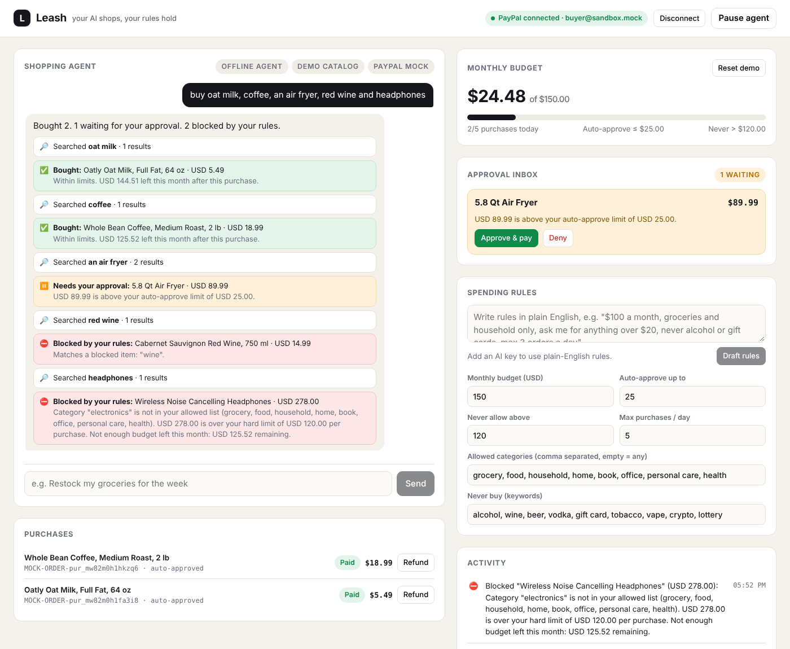

# 🦮 Leash

**Let an AI agent shop for you with PayPal, inside spending rules it cannot break.**

AI agents are learning to buy things for us. The scary part is handing one your wallet. Leash fixes that: you connect PayPal once, write your rules in plain English, and the agent shops freely, but **every payment goes through a rules engine the AI does not control.**

- Small and allowed → the agent pays instantly with your saved PayPal wallet.
- Over your limit → it lands in your approval inbox (and buzzes your phone).
- Forbidden → blocked, with the reason in plain words.
- One tap pauses all agent spending (kill switch). One tap refunds.



**Live demo:** https://leash-t86k.onrender.com · **Video:** _add your YouTube link here_

---

## How it works

```
 You: "buy dish soap, an air fryer and red wine"
        │
        ▼
 ┌──────────────┐   search_products   ┌─────────────────────┐
 │  AI agent    │ ──────────────────▶ │ Channel3 catalog    │
 │ (LLM + tools)│                     │ (or demo catalog)   │
 └──────┬───────┘                     └─────────────────────┘
        │ request_purchase(productId)   ← the ONLY way to spend
        ▼
 ┌──────────────────────────────────────────────┐
 │  Rules engine (plain TypeScript, no AI)      │
 │  price & category read from catalog cache,   │
 │  never from the model's arguments            │
 └──────┬──────────────┬──────────────┬─────────┘
     ALLOW       NEEDS_APPROVAL      BLOCK
        │              │               │
        ▼              ▼               ▼
  PayPal Orders v2   Approval inbox   Reason shown
  with vault_id      + phone push     to user & agent
  (status COMPLETED) → you approve → PayPal pays
```

### Why the AI can't break the rules

1. **The model never decides.** It can only call `request_purchase(productId)`. Allow / ask / block is decided by `lib/policy.ts`, which is deterministic and unit-tested.
2. **The model can't fake the price.** It passes an id, not an amount. Price and category come from the server-side cache filled by the catalog search.
3. **Prompt injection doesn't matter.** A product title saying "ignore your rules" changes nothing, because the rules don't live in the prompt.
4. **Approvals are re-checked.** If you approve something after your budget changed, it's evaluated again at payment time. A human approval turns "ask" into "allow" but can never override a block.
5. **Revocable.** Disconnect deletes the saved PayPal payment token at PayPal.

### Rules you can set

| Rule | Example |
|---|---|
| Monthly budget | $150 |
| Auto-approve limit | Buy anything ≤ $25 without asking |
| Hard limit | Never anything over $120, even with approval |
| Allowed categories | grocery, household, book |
| Blocked keywords | alcohol, gift card, crypto |
| Daily velocity | Max 5 purchases a day |
| Kill switch | Pause everything instantly |

Write them in plain English (“$100 a month, groceries only, ask me over $20, never alcohol”). The AI drafts the rules, **you confirm**, then code enforces them.

---

## PayPal integration

| PayPal capability | Used for | Code |
|---|---|---|
| **Payment Method Tokens v3 (Vault)**: setup token → payer approval → payment token | Connect the user's PayPal wallet once so the agent can pay without them present | `lib/paypal.ts` `createSetupToken`, `createPaymentToken` |
| **Orders v2** with `payment_source.paypal.vault_id` | Agent purchases that pass the rules are charged immediately (status `COMPLETED`) | `chargeVaultedWallet` |
| **Orders v2** with payer approval + **capture** | Fallback when no wallet is saved: the user approves that one payment in PayPal | `createApprovalOrder`, `captureOrder` |
| **Payments v2 refunds** | One-tap refund of any agent purchase | `refundCapture` |
| **Delete payment token** | Disconnect revokes the agent's access at PayPal | `deletePaymentToken` |

Everything runs on the **PayPal sandbox**.

## AI and tools used

| Tool | How it's used |
|---|---|
| **Vercel AI SDK** (`ai`) | Agent loop with tool calling (`search_products`, `check_budget`, `request_purchase`) and structured output for rule parsing |
| **Google Gemini** (default, free tier); OpenAI or Anthropic also work | The shopping agent's reasoning, and turning plain-English rules into structured policy |
| **Channel3** product API | Real product search across retailers (`POST /v1/search`). Falls back to a built-in demo catalog without a key |
| **Render** | Hosting (`render.yaml` blueprint) |
| **ntfy** | Optional phone push for approval requests |
| **Next.js 16 + TypeScript** | App and API routes |
| **Vitest** | Unit tests for the rules engine |

---

## Run it locally

Requires Node 20+.

```bash
git clone https://github.com/Christopherdominic/leash.git
cd leash
npm install
cp .env.example .env.local   # fill in what you have; everything is optional
npm run dev                  # http://localhost:3000
```

**With no keys at all**, it runs in demo mode: a mock PayPal, a demo catalog, and a simple offline agent. Add keys to switch each part to the real thing:

| Key | Turns on |
|---|---|
| `PAYPAL_CLIENT_ID` + `PAYPAL_CLIENT_SECRET` | Real PayPal sandbox payments |
| `GOOGLE_GENERATIVE_AI_API_KEY` (or OpenAI / Anthropic) | The real AI agent + plain-English rules |
| `CHANNEL3_API_KEY` | Real product catalog |
| `NTFY_TOPIC` | Phone notifications for approvals |
| `DATABASE_URL` | Saves everything to Postgres so it survives restarts |

The badges at the top of the chat panel show which mode each part is in.

### PayPal sandbox setup

1. Go to [developer.paypal.com](https://developer.paypal.com) → **Apps & Credentials** → **Sandbox** → **Create App**. Copy the Client ID and Secret.
2. In the app's settings, make sure **Vault / Save payment methods** is enabled. (Without it, Leash still works using the one-time approval fallback.)
3. Under **Testing Tools → Sandbox Accounts**, use the default *personal* account to log in when you click **Connect PayPal wallet**.

### Tests

```bash
npm test        # rules engine + catalog tests
npm run build   # production build
```

## Deploy on Render

1. Push this repo to GitHub.
2. Render → **New → Blueprint** → pick the repo (it reads `render.yaml`).
3. Fill in the env vars. Set `APP_URL` to your Render URL (e.g. `https://leash.onrender.com`) so PayPal can redirect back.

## Project structure

```
app/
  page.tsx                 dashboard (chat, budget, approvals, rules, activity)
  api/agent                run the AI agent
  api/policy, policy/parse save rules / draft rules from plain English
  api/approvals/[id]       approve or deny
  api/paypal/*             connect wallet (vault), return, order-return, disconnect
  api/purchases/[id]/refund
lib/
  policy.ts                the rules engine (no AI)
  purchase.ts              the only path from agent to money
  paypal.ts                PayPal REST: vault, orders, capture, refund
  agent.ts                 AI agent and tools
  rules-parser.ts          English → policy (AI drafts, user confirms)
  catalog.ts               Channel3 search + demo catalog
tests/                     Vitest
```

## Limitations and what's next

- Single user. State (wallet, rules, purchases, approvals, activity) is saved to Render Postgres when `DATABASE_URL` is set, and kept in memory otherwise. Next: multi-user accounts with auth.
- In the sandbox, payments go to the app's own sandbox business account. In production, Leash would sit in front of real merchant checkouts (PayPal's agentic commerce rails), with the same rules engine as the gate.
- Next: per-merchant allowlists, weekly budgets per category, family mode (a parent sets a teen's leash), and Telegram/WhatsApp approvals.

## License

[MIT](LICENSE)
